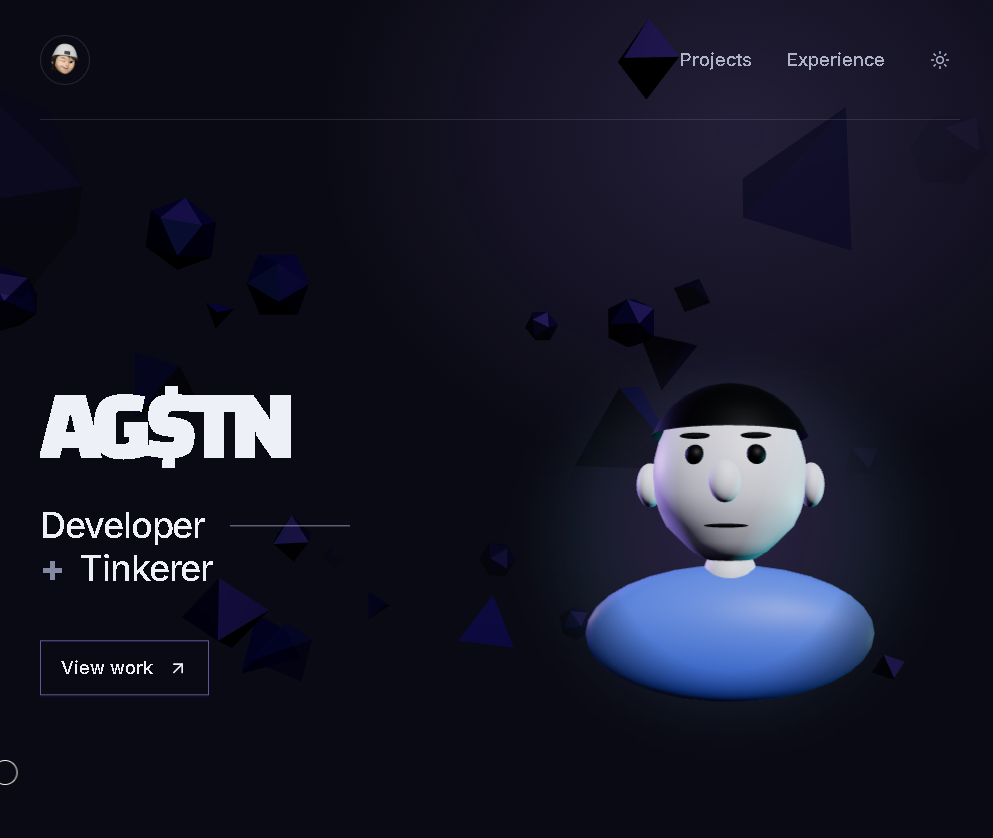

# AGSTN Portfolio

Personal developer portfolio for **AGSTN** — BSIT student and independent developer in the Philippines.



> **Source code is private.** This repository is not public and the code is not licensed for reuse.

## Stack

- **Vite + React 19** (JavaScript/JSX)
- **Tailwind CSS v4** via `@tailwindcss/vite`
- **Three.js + @react-three/fiber** for 3D (portrait, ambient background, project object)
- **GSAP + ScrollTrigger** for scroll-driven reveals
- **Lucide React** for icons

## Features

- **Experience Journey** — scroll-driven hero that transitions into an About section, then a timeline. Portrait slides left, opacity/focus shifts hand over between panels.
- **Biometric Portrait** — interactive 3D model (GLB) that blinks and follows the cursor while the pointer is over the hero; keeps last direction on leave.
- **Drift Background** — ambient Three.js scene with floating geometric shapes; color mood shifts with scroll; includes a pinned 3D **DocketObject** that appears alongside its project row.
- **Projects & Stack** — editorial project rows (linkified when real URLs exist), grouped technology stack.
- **Custom Cursor** — desktop-only, transform-only RAF loop, shrinks to a filled dot over interactive elements.
- **Wordmark** — `AG$TN` reveals letter-by-letter twice with a random replay delay, then stays visible.
- **RoleSwap** — GSAP-powered word cycle: `Developer + Builder / Explorer / Tinkerer`.
- **Theme Toggle** — View Transition API circle reveal from click position; respects `prefers-reduced-motion`.
- **Accessibility** — semantic HTML, ARIA labels, `inert`/`aria-hidden` during scroll transitions, visible focus styles, keyboard navigation.
- **Reduced Motion** — every animation respects `prefers-reduced-motion: reduce` (static fallbacks, no motion-dependent content).
- **Responsive** — mobile-first, breakpoints at 760px and 1023px; custom cursor only on `hover: hover` + `pointer: fine` + `min-width: 768px`.

## Project Structure

```
src/
├── App.jsx                 # Page composition, theme toggle, background lazy-load
├── index.css               # Design tokens, journey/timeline styles, responsive, reduced-motion
├── main.jsx                # Entry point
├── components/
│   ├── BiometricPortrait.jsx
│   ├── CustomCursor.jsx
│   ├── DriftBackground.jsx
│   ├── DocketObject.jsx
│   ├── ExperienceJourney.jsx
│   ├── ExperienceTimeline.jsx
│   ├── PortfolioSections.jsx
│   ├── ProjectCard.jsx
│   ├── ProjectsSection.jsx
│   ├── RoleSwap.jsx
│   ├── SectionHeading.jsx
│   ├── SiteFooter.jsx
│   ├── SiteNavigation.jsx
│   ├── SocialLink.jsx
│   ├── StackSection.jsx
│   ├── Wordmark.jsx
│   ├── PortraitModel.jsx
│   └── portraitStates.js
├── data/
│   └── portfolioData.js    # Projects, stack groups, social links, credits
└── hooks/
    └── useScrollReveals.js # GSAP ScrollTrigger wrapper (data-* declarative reveals)
```

Top level: `previews/` holds the approved standalone HTML previews (not imported by the app or shipped in the build); `archive/` is historical and never imported.

## Getting Started

```bash
# Install dependencies
npm install

# Development server
npm run dev

# Production build
npm run build

# Preview production build
npm run preview
```

## Content

All copy lives in `src/data/portfolioData.js` and `src/components/ExperienceTimeline.jsx` — edit there, not in presentation components.

- **Projects**: add objects to `projects` array; include `href` to make a row a link. Dev-only sample rows are marked `placeholder: true` and are excluded from production builds.
- **Stack**: edit `stackGroups` (title + items).
- **Social**: edit `socialLinks` (label + href).
- **Timeline**: add milestone objects to `milestones` in `ExperienceTimeline.jsx`.
- **Credits**: edit `inspiredBy` in `portfolioData.js`.

## Design Tokens (CSS Custom Properties)

Defined in `src/index.css` under `:root` (light) and `.dark`:

| Token | Purpose |
|-------|---------|
| `--page-bg` | Page/body background (also the selection text colour) |
| `--primary-text` | Headings, high-contrast text |
| `--secondary-text` | Body copy |
| `--muted-text` | Metadata, labels |
| `--primary-accent` | Violet (glow, hover, focus ring, selection) |
| `--secondary-accent` | Cyan (secondary glow, rim) |
| `--hairline` | Dividers, borders |
| `--portrait-halo` | Portrait radial glow |
| `--selection-bg` / `--selection-text` | Text selection |
| `--scrollbar` / `--scrollbar-hover` | Scrollbar thumb |
| `--shape-1..3`, `--fog`, `--ambient` | Drift background shapes, fog, ambient light |
| `--docket-panel` / `--docket-accent` / `--docket-edge` | Docket 3D object |
| `--glow-1..4`, `--glow`, `--fill` | Key-light cycle, scroll glow, fill light |
| `--hemi-sky`, `--hemi-ground`, `--portrait-key`, `--rim-1`, `--rim-2` | Portrait 3D lights |

Violet (`--primary-accent`) and cyan (`--secondary-accent`) act as light sources — glow, hover, focus and thin accents — never large fills. The 3D layer reads these tokens at runtime through `src/themeColors.js`, so no component hard-codes a colour.

## Deployment

Build output lands in `dist/`. Deploy to any static host (Vercel, Netlify, Cloudflare Pages, GitHub Pages, etc.).

```bash
npm run build
# deploy dist/
```

## License

All rights reserved. The source code is private and is not licensed for reuse.